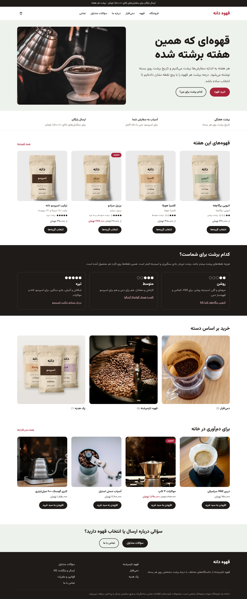

# فروشگاه قهوه «دانه» — نمونه‌کار ووکامرس

> **نمونه‌کار شخصی.** برند، محصولات، قیمت‌ها و اطلاعات تماس ساختگی‌اند. عکس‌ها از Pexels با مجوز استفاده رایگان‌اند. هیچ سفارشی ارسال و هیچ پرداختی دریافت نمی‌شود.

فروشگاه اینترنتی فارسی و راست‌به‌چپ با وردپرس و ووکامرس. شامل یک **پوسته بلوکی اختصاصی** و یک **افزونه** است که با یک کلیک کل فروشگاه نمونه را می‌سازد: ۱۲ محصول (۶ قهوه با گزینه وزن و آسیاب)، تسویه حساب ایرانی، هزینه ارسال بر اساس استان، روش‌های پرداخت، کد تخفیف، برگه‌ها و منو.



## محتوای این بسته

| مسیر | چیست |
| --- | --- |
| `dist/dane-theme.zip` | پوسته «دانه»؛ از پیشخوان نصب می‌شود |
| `dist/dane-store-plugin.zip` | افزونه «Dane Store»؛ از پیشخوان نصب می‌شود |
| `source/` | کد منبع پوسته و افزونه، برای GitHub |
| `docs/owner-guide.pdf` | راهنمای دوصفحه‌ای مدیریت فروشگاه برای صاحب کسب‌وکار |
| `docs/BRAND.md` | هویت برند: رنگ‌ها، برچسب بسته، قواعد عکاسی و ایده‌های بعدی |
| `docs/PHOTOS.md` | منبع و مجوز عکس‌ها، و روش جایگزینی با عکس خودتان |
| `docs/TEST-REPORT.md` | گزارش تست‌ها و باگ‌هایی که حین ساخت پیدا و رفع شد |
| `docs/CASE-STUDY.md` | متن آماده نمونه‌کار برای پونیشا و پورتفولیو |
| `docs/screenshots/` | تصاویر دسکتاپ و موبایل |
| `tests/` | تست خودکار خرید کامل با Playwright |

## پیش‌نیازها

- وردپرس ۶٫۵ یا بالاتر (تست‌شده روی **۷٫۱٫۳**)
- ووکامرس ۹ یا بالاتر (تست‌شده روی **۱۱٫۲٫۱**)
- PHP نسخه ۷٫۴ یا بالاتر (تست‌شده روی **۸٫۳**)

## نصب روی LocalWP (حدود ۱۵ دقیقه)

1. در LocalWP یک سایت جدید با نام `dane` بسازید (گزینه Preferred کافی است). نشانی سایت می‌شود `http://dane.local`.
2. وارد پیشخوان شوید. در **تنظیمات ← عمومی ← زبان سایت**، «فارسی» را انتخاب و ذخیره کنید.
3. **افزونه‌ها ← افزودن** ← «WooCommerce» را جست‌وجو، نصب و فعال کنید. اگر راهنمای راه‌اندازی ووکامرس باز شد، آن را رد کنید.
4. **پیشخوان ← به‌روزرسانی‌ها** ← «به‌روزرسانی ترجمه‌ها» را بزنید تا ووکامرس هم فارسی شود.
5. **نمایش ← پوسته‌ها ← افزودن ← بارگذاری پوسته** ← فایل `dist/dane-theme.zip` را نصب کنید. فعال کردن لازم نیست؛ مرحله ۷ خودش فعال می‌کند.
6. **افزونه‌ها ← افزودن ← بارگذاری افزونه** ← فایل `dist/dane-store-plugin.zip` را نصب و فعال کنید.
7. **ابزارها ← دموی فروشگاه دانه** ← «ساخت فروشگاه نمونه». حدود ۱۰ ثانیه طول می‌کشد و فهرست کارهای انجام‌شده را نشان می‌دهد.
8. سایت را باز کنید.

اجرای دوباره مرحله ۷ محصول تکراری نمی‌سازد؛ فقط تنظیمات را دوباره اعمال می‌کند. روی سایتی که با نسخه قبلی ساخته شده، اجرای دوباره آن تصویرسازی‌های قدیمی را با عکس‌های جدید عوض می‌کند و به عکس‌هایی که خودتان بارگذاری کرده‌اید دست نمی‌زند.

## یک خرید آزمایشی

1. «اتیوپی یرگاچفه» را باز کنید، وزن و نوع آسیاب را انتخاب و به سبد اضافه کنید.
2. در سبد خرید کد `WELCOME10` را وارد کنید.
3. در تسویه حساب، استان را یک بار «اصفهان» و یک بار «تهران» بگذارید. روش ارسال و «پرداخت در محل» بر اساس استان تغییر می‌کند.
4. کد پستی و موبایل را با ارقام فارسی وارد کنید؛ پذیرفته می‌شود. عدد اشتباه هم پیام خطای فارسی می‌دهد.
5. سفارش را ثبت کنید و آن را در **ووکامرس ← سفارش‌ها** ببینید.

ایمیل‌های سفارش در LocalWP واقعاً ارسال نمی‌شوند؛ آن‌ها را در زبانه **Mailpit** (یا Email) خود LocalWP ببینید.

## امکانات

**برند و تصاویر**
- هویت برند «دانه»: برچسب اختصاصی روی بسته کرافت، رنگ جدا برای هر خاستگاه و نقطه‌های درجه برشت ([BRAND.md](docs/BRAND.md))
- عکس اصلی و عکس دوم گالری برای همه محصولات، تصویر دسته‌ها و صفحه اصلی

**پوسته «دانه»** (بلوکی، قابل ویرایش در ویرایشگر سایت)
- طراحی فارسی و راست‌به‌چپ با فونت وزیرمتن داخل پوسته (بدون وابستگی به CDN خارجی)
- راهنمای «کدام برشت برای شماست؟» و نمایش درجه برشت با پنج نقطه روی هر کارت
- صفحات فروشگاه با قالب کلاسیک ووکامرس، برای سازگاری با افزونه‌های ایرانی
- سبد خرید در سربرگ با شمارنده‌ای که بدون بارگذاری صفحه به‌روز می‌شود
- بدون اسکرول افقی از عرض ۳۲۰ پیکسل؛ Focus قابل مشاهده برای صفحه‌کلید

**افزونه Dane Store**
- تسویه حساب ایرانی: ترتیب نام، نام خانوادگی، استان، شهر، نشانی، کد پستی، موبایل و ایمیل (اختیاری)؛ بدون نام شرکت و نشانی دوم
- اعتبارسنجی کد پستی ۱۰ رقمی و موبایل ۰۹ با پذیرش ارقام فارسی، فاصله و خط تیره
- قیمت‌ها با ارقام فارسی، و «از ۴۲۰٬۰۰۰ تومان» به‌جای بازه قیمت
- فیلدهای درجه برشت، خاستگاه و طعم در ویرایشگر محصول
- «پرداخت در محل» فقط برای پیک تهران؛ پنهان شدن ارسال پولی وقتی ارسال رایگان شامل سفارش می‌شود
- نام فارسی استان‌ها و ترجمه پشتیبان فارسی برای وقتی که بسته زبان ووکامرس هنوز نصب نشده
- ابزار راه‌اندازی یک‌کلیکی در پیشخوان و دستور `wp dane setup` برای WP-CLI
- ابزار «تصاویر محصولات»: چند عکس را با هم بارگذاری کنید تا هر کدام بر اساس نام فایل روی محصول خودش بنشیند

## عیب‌یابی

| مشکل | راه‌حل |
| --- | --- |
| صفحه محصول خطای ۴۰۴ می‌دهد | **تنظیمات ← پیوندهای یکتا** را باز کنید و بدون تغییر «ذخیره» بزنید |
| بخشی از متن‌های فروشگاه انگلیسی است | مرحله ۴ نصب (به‌روزرسانی ترجمه‌ها) را انجام دهید |
| سایت چپ‌به‌راست است | زبان سایت را در مرحله ۲ روی «فارسی» بگذارید |
| روش «پرداخت در محل» دیده نمی‌شود | فقط برای استان تهران فعال است؛ این رفتار عمدی است |
| بعد از نصب افزونه پیام «به ووکامرس نیاز دارد» آمد | اول ووکامرس را فعال کنید |

## اتصال درگاه پرداخت واقعی

این دمو درگاه اینترنتی ندارد. برای فروشگاه واقعی، افزونه رسمی درگاه را از شرکت پرداخت دریافت و نصب کنید. صفحه تسویه حساب کلاسیک است و بیشتر درگاه‌های ایرانی از آن پشتیبانی می‌کنند. پیش از فعال کردن، یک پرداخت آزمایشی انجام دهید.

## اجرای تست‌های خودکار (اختیاری)

```bash
pip install playwright
cd tests
DANE_BASE=http://dane.local python flow_test.py d   # دسکتاپ
DANE_BASE=http://dane.local python flow_test.py m   # موبایل
DANE_BASE=http://dane.local python small_order_test.py
```

در ویندوز، تست‌ها با Microsoft Edge نصب‌شده روی سیستم اجرا می‌شوند و دستور `playwright install` لازم نیست؛ دانلود مرورگر Playwright در ایران مسدود است. اگر Edge ندارید و Chrome نصب است: `$env:PW_CHANNEL="chrome"`

در ویندوز (PowerShell) به‌جای `DANE_BASE=... python ...` بنویسید: `$env:DANE_BASE="http://dane.local"; python flow_test.py d`

تست‌ها روی **سایت آزمایشی** سفارش ثبت می‌کنند. روی سایت واقعی اجرا نکنید.

## مجوزها

- پوسته و افزونه: GPL-2.0-or-later
- فونت وزیرمتن: SIL Open Font License 1.1 (`source/dane/assets/fonts/OFL.txt`)
- عکس‌ها: Pexels License (استفاده رایگان و تجاری)؛ برچسب‌های بسته طراحی همین پروژه است. فهرست عکاسان در `docs/PHOTOS.md`.
